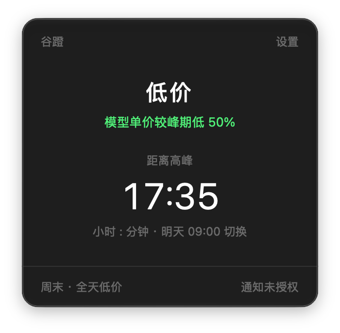
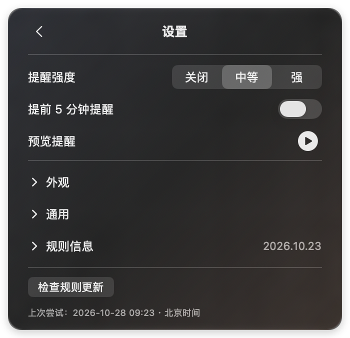

# 谷蹬

<p align="center">
  
</p>

> **DeepSeek API 峰谷钟点提醒**
>
> 一个极简的 API 峰谷价格时钟：现在贵还是便宜、距离下次切换还有多久、切换时怎么提醒我。

谷蹬常驻 macOS 菜单栏，用「峰 / 谷 + 剩余时间」回答 DeepSeek API 的当前价格时段。点击展开一个小面板，只显示价格状态、模型单价差异、下一切换倒计时和一句日期摘要。它不做账号、API Key、用量统计、任务调度，也不会替你切换模型。

> 本项目是社区项目，与 DeepSeek 官方无隶属关系。价格以 [DeepSeek 官方价格页](https://api-docs.deepseek.com/zh-cn/quick_start/pricing/) 为准。

[](https://github.com/EasyIndie/EasyAPIClock/actions/workflows/ci.yml)
[](https://github.com/EasyIndie/EasyAPIClock/actions/workflows/rules.yml)


> 仓库：<https://github.com/EasyIndie/EasyAPIClock>。产品页：[EasyAPIClock GitHub Pages](https://easyindie.github.io/EasyAPIClock/)。发布步骤见 [`docs/ops/release.md`](docs/ops/release.md)。

## 截图

<p align="center">
  
  
</p>

> 真实截图（macOS 27，深色外观），不是设计稿。截图机器未授予通知权限，因此主面板显示「通知未授权」、设置页显示「系统通知未开启」；这是应用的真实降级提示。

## 当前状态

这是 **v0.1.0 工程脚手架**，不是已发布产品。

| 能力 | 状态 |
|---|---|
| 北京时间峰谷规则、节假日覆盖、下次真实切换计算 | ✅ 已实现；当前全套77个单元测试 |
| 内置 2026 价格与节假日规则包，SHA-256 校验 | ✅ 已实现 |
| macOS 菜单栏、主面板、内嵌设置、本地提醒偏好 | ✅ 已实现并可通过 `make run-mac` 启动 |
| 中等 / 强提醒的通知计划、去重、拒绝补发历史通知 | ✅ 计划/去重已实现；macOS 27 已验权限拒绝降级；2026-10-27 安装签名版授权允许并取得预览系统送达记录，正式平台矩阵待完 |
| 远程规则包下载、完整性校验、原子替换、未来生效 | ✅ 机制已实现；默认指向仓库 `rules` 分支，由 Rules workflow 发布 |
| iOS 共享引擎 | ✅ 最小外壳，仅用于验证跨平台核心 |
| 发布打包 | ✅ `make package-mac` 生成通用二进制 zip/dmg（默认 ad-hoc）；GitHub Release 调用 EasyIndie/EasyRelease reusable workflow；公证待凭据 |
| 应用图标 | ✅ 1024pt 峰谷分色时钟，AppIcon 全套尺寸；`make icon` 可重建 |
| iOS 交互设计 | ⛔ 尚未确认，当前外壳不代表正式设计 |
| 公证、英文界面 | ⛔ 未完成 |
| 规则包数字签名 | ⛔ 仅 SHA-256 完整性校验，见 [ADR-0004](docs/adr/0004-rule-bundles.md) |

设计基准是 [`docs/handoff/design-preview.html`](docs/handoff/design-preview.html)。用浏览器直接打开即可查看，它是交互示意，不是生产实现。

## 图形界面启动

本地安装位置使用 `/Applications/谷蹬.app`（本次开发机已完成安装）。在Finder的“应用程序”中双击“谷蹬”即可启动；它只在菜单栏显示入口，不打开常驻窗口或Dock窗口。收起面板时点击菜单栏图标重开；主面板右下电源图标用于退出，退出后从“应用程序”重新启动。对外下载入口为[最新 GitHub Release](https://github.com/EasyIndie/EasyAPIClock/releases/latest)。

开发构建放在隐藏的.build目录，不是日常入口。本机安装版采用已有 Developer ID 做本地签名，尚未公证。公开 Release 计划提供 ad-hoc 包：macOS 可能拦截首次启动，用户需要在 Finder 选择“打开”；这不等同 Developer ID 签名或公证。

## 快速开始

应用最低构建目标：macOS13.0，iOS维持17.0。macOS13.7.8 Intel真机已原生启动并完成菜单栏、设置及偏好跨重启持久化检查；arm64的macOS13、登录启动与完整通知矩阵仍待验，见[兼容记录](docs/ops/macos-13-compatibility.md)。

开发主机要求：macOS14+、Xcode16+（Swift6），具体主机版本还需满足所用Xcode要求。XcodeGen 由脚本安装固定版本，无需手动 `brew install`。

```bash
make bootstrap     # 安装固定 2.46.0 XcodeGen（SHA-256 校验）+ 生成工程 + 环境检查
make doctor        # 检查 macOS / Xcode / Swift / XcodeGen
make test          # 运行核心与界面文案测试
make validate-rules
make run-mac       # 构建并以 ad-hoc 签名启动菜单栏应用
make build-mac-universal  # Release双架构及13.0最低系统元数据检查
make package-mac   # Release 通用二进制 + zip/dmg（ad-hoc，本地验证）
make serve-test-rules  # 生成近期切换测试规则并启动本地服务器
make icon          # 重新生成 macOS AppIcon 全套尺寸
```

XcodeGen 版本固定在 [`.xcodegen-version`](.xcodegen-version)，安装脚本只下载官方 release 并校验 SHA-256；不会使用“latest”。

`LiangWenClock.xcodeproj` 是生成产物，不提交到仓库。`LiangWenClock` 是暂保留的工程技术标识；对外产品名为「谷蹬」。修改工程结构请编辑 [`project.yml`](project.yml)。

只运行 SwiftPM 部分：

```bash
swift test --package-path Packages/LiangWen
swift run --package-path Packages/LiangWen liangwen-rules validate Rules
```

## 项目结构

```
Apps/
  Mac/                 macOS 菜单栏外壳（MenuBarExtra、唤醒/改时刷新）
  iOS/                 最小 iOS 外壳（仅验证共享引擎，设计未确认）
Packages/LiangWen/
  Sources/LiangWenCore   纯逻辑：规则、日历、引擎、提醒计划、更新校验
  Sources/LiangWenRuntime 共享业务会话、值状态、规则仓库与能力协议
  Sources/LiangWenKit    SwiftUI界面适配、中文文案、系统偏好/通知/登录项
  Sources/LiangWenRuleTool 规则包校验与 manifest 重新计算 CLI
Rules/                 内置规则包（价格、2026 节假日、提醒策略、manifest）
Scripts/               固定版本工具安装、开发环境检查
docs/                  产品、架构、ADR、运维与原始交接包
```

依赖方向固定为 `Apps → LiangWenKit → LiangWenRuntime → LiangWenCore`。`LiangWenCore` 不依赖 SwiftUI、AppKit 或网络，所有时间答案由传入的 `Date` 和已验证规则决定。共享业务接入见 [SDK边界](docs/architecture/shared-sdk.md)；`make check-layers`检查UI依赖不会进入业务模块。

## 关键约束

- 所有价格状态按 **Asia/Shanghai** 计算，不随设备时区改变。
- 周末与法定节假日全天为谷；调休上班的周六/周日 **不会** 变成峰。
- 时段是左闭右开：09:00 属峰，12:00 属谷，14:00 属峰，18:00 属谷。
- 倒计时指向真正的状态变化，不会在周末/假期午夜制造伪切换。
- 日期数据过期或缺失时显示「规则待更新」，暂停无法确认的价格提醒，不伪装成准确状态。
- 规则更新只接受声明式 JSON，不执行远程代码；更新不能覆盖用户选择的提醒强度。
- 启动、唤醒或改时后只安排未来事件，不补发历史通知。

更完整的产品与验收要求见 [`docs/product/requirements.md`](docs/product/requirements.md)。

## 规则数据

`Rules/` 中的价格快照核对于 **2026-10-23**，节假日依据国务院办公厅 2026 年放假安排整理。价格与政策会变化；发布前、以及每年新节假日安排公布后都需要重新核对。

```bash
# 修改 JSON 后重新计算 manifest 校验和
make rules-manifest

# 校验整个规则包
make validate-rules
```

`Rules/` 是唯一数据源。合并到 `main` 后，[`Rules` workflow](.github/workflows/rules.yml) 会重新校验并发布到独立的 `rules` 分支；应用默认读取：

```
https://raw.githubusercontent.com/EasyIndie/EasyAPIClock/rules
```

`rules` 分支是生成物，不要手工编辑。发布要求 `publishedAt` 严格递增，否则发布 job 会失败。CDN 可能有数分钟缓存。

更新流程、来源要求和回滚方式见 [`docs/ops/rule-update-runbook.md`](docs/ops/rule-update-runbook.md)，托管决策见 [ADR-0007](docs/adr/0007-github-rules-branch.md)。

## 文档

- [文档索引与权威顺序](docs/README.md)
- [产品概览](docs/product/overview.md) · [需求与验收](docs/product/requirements.md) · [Mac 设计基准](docs/product/design-macos.md)
- [架构概览](docs/architecture/overview.md) · [规则与数据](docs/architecture/rules-and-data.md) · [时间与日历](docs/architecture/time-and-calendar.md) · [提醒](docs/architecture/reminders.md) · [测试](docs/architecture/testing.md)
- [路线图](docs/roadmap.md) · [发布](docs/ops/release.md) · [平台验证清单](docs/ops/platform-validation.md)
- [给 AI 开发代理的约定](AGENTS.md) · [任务清单](TASKS.md)

## 参与

提交前请阅读 [`CONTRIBUTING.md`](CONTRIBUTING.md) 与 [`AGENTS.md`](AGENTS.md)。涉及价格或节假日的改动必须附官方来源、核对日期，并重新生成 manifest。

安全问题请按 [`SECURITY.md`](SECURITY.md) 私下报告，不要公开提交可利用细节。

## English summary

Gudeng (谷蹬) is a minimal, open-source API price-window clock for macOS (with a shared Swift core and an iOS shell). It shows whether DeepSeek API model tokens are currently in peak or valley pricing, the next real transition, and an optional notification. Rules are declarative JSON with SHA-256-verified bundles; the app never executes remote code and always degrades to "rules need update" instead of guessing. The Chinese subtitle is “DeepSeek API 峰谷钟点提醒”. The project is not affiliated with DeepSeek. See `docs/architecture/` for the design.

## License

[MIT](LICENSE) © 2026 Gudeng contributors.

`make run-mac` 会在构建成功后退出同一 ad-hoc 构建路径的旧实例，再启动最新二进制；不会按应用名终止其他安装路径。旧实例未在限定时间退出时命令会失败，需手动退出后重试。

Mac 设置支持测试提醒预览、登录时启动和自动规则更新。预览与正式通知隔离并在十秒内结束；未授权时只提示权限状态。登录启动默认不主动注册，以系统状态为准。自动规则更新默认开启，自动尝试间隔至少六小时，关闭后仍能手动检查。iOS 外壳不提供这些设置；真实通知投递和实际重新登录启动仍待目标系统验证。

2026-10-27安装版补验：登录项notFound可能只是从未注册，现允许用户主动注册并展示真实结果；“页面切换动效”仅控制主面板/设置淡入淡出，尊重减少动态效果。通用设置显示最近一次自动检查尝试（含失败），时间为北京时间；手动检查不改该记录。详见installed-features验收目录。

## 官方价格变化与品牌识别

主面板标识DeepSeek API峰谷价格提醒，应用图标为原创时间环/谷口，不是DeepSeek官方标志。蓝靛品牌色与谷期青绿/峰期珊瑚分开；界面动效覆盖入场、可用系统的数字变化、折叠和交互反馈，均可关闭并遵守减少动态效果。

新增Official pricing CI：小时观察官方HTTPS价格页，检测差异并维护去重复核issue。维护者确认摘要、官方生效时刻与依据后，才可生成通过校验的单价候选草稿PR；合并后沿用原Rules发布。当前分支合并默认分支后才有定时运行，不是已上线的无人值守自动改价。详见[操作说明](docs/ops/official-pricing-automation.md)。make check现在包含10项Python离线监测测试，Swift仍77项。
